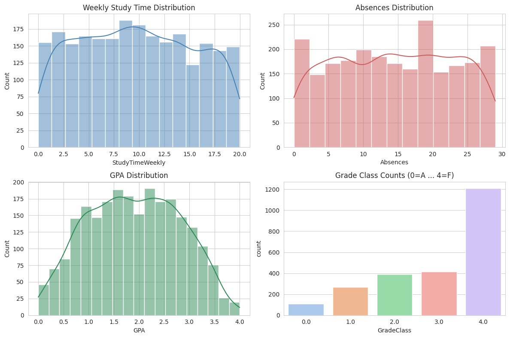
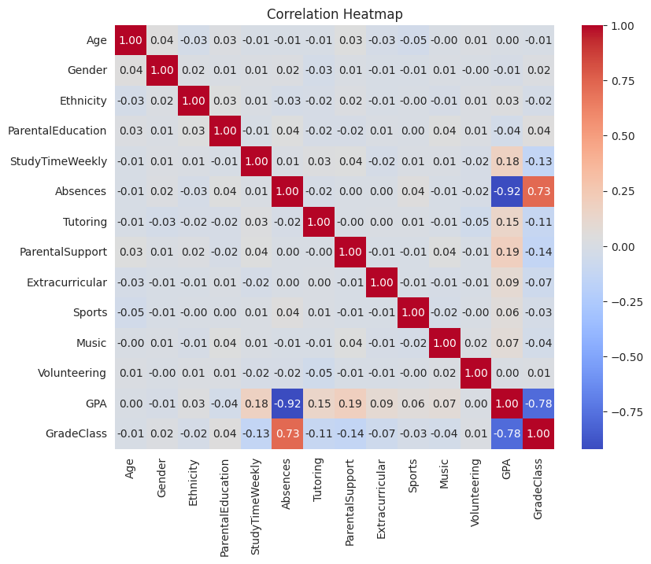
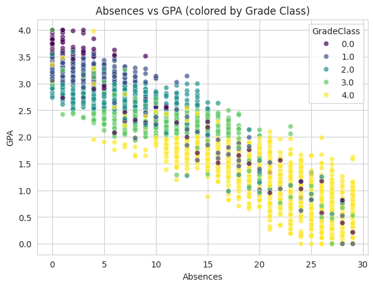
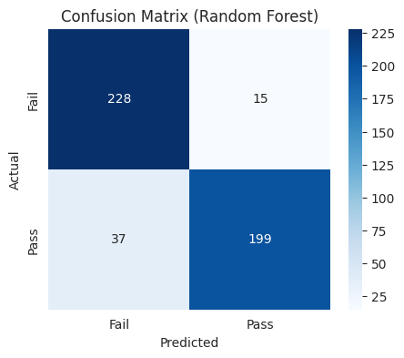
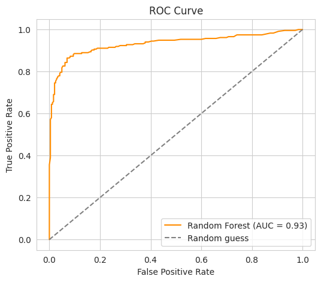
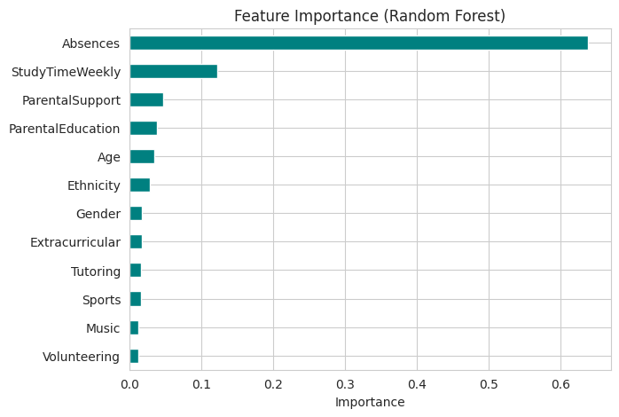
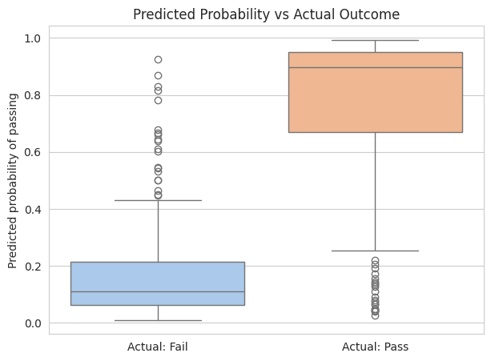

# 🎓 Student Success Predictor

An end-to-end machine learning notebook that predicts whether a student will **pass or fail** from study habits, attendance, and family/background factors. It compares a **Logistic Regression** baseline against a **Random Forest** classifier and visualises everything with Matplotlib and Seaborn.


---

## 📌 Highlights

- **2,392 students**, 14 columns, no missing values and no duplicates.
- Binary target: **Pass** (`GradeClass` A–D) vs **Fail** (`GradeClass` F).
- `GPA` and `GradeClass` are **excluded from the features** to avoid label leakage.
- **`Absences` is by far the strongest predictor** of failure (~64% of Random Forest feature importance), followed by `StudyTimeWeekly` (~12%) and `ParentalSupport` (~5%).
- Test-set results (80/20 stratified split, `random_state=42`):

| Model | Accuracy | Notes |
|---|---|---|
| Logistic Regression (scaled features) | **0.906** | Baseline, best accuracy here |
| Random Forest (300 trees) | 0.891 | ROC AUC **0.93**, gives feature importances |

---

## 📂 Project Structure

```
.
├── data/
│   └── student_performance_data.csv     # Dataset (2,392 rows)
├── notebooks/
│   └── Student_Success_Predictor.ipynb  # Full pipeline with outputs
├── images/                              # Plots used in this README
├── requirements.txt
├── LICENSE
└── README.md
```

## 🗂️ Dataset

| Column | Description |
|---|---|
| `StudentID` | Unique ID (dropped before modelling) |
| `Age` | 15–18 |
| `Gender` | 0 / 1 |
| `Ethnicity` | Encoded 0–3 |
| `ParentalEducation` | Encoded 0–4 |
| `StudyTimeWeekly` | Study hours per week (0–20) |
| `Absences` | Absences during the year (0–29) |
| `Tutoring` | Receives tutoring (0 / 1) |
| `ParentalSupport` | Encoded 0–4 |
| `Extracurricular`, `Sports`, `Music`, `Volunteering` | Activity flags (0 / 1) |
| `GPA` | Grade point average (0–4), not used as a feature |
| `GradeClass` | 0 = A, 1 = B, 2 = C, 3 = D, 4 = F (used to build the target) |

## 🔄 Pipeline

1. Import libraries
2. Load the dataset
3. Clean the data (check missing values and duplicates, drop `StudentID`)
4. Explore the data (EDA)
5. Preprocess: build the `success` target, train/test split, scale features
6. Train Logistic Regression and Random Forest
7. Predict on the test set and on a new hypothetical student
8. Plot and interpret the results

---

## 📊 Results and Visualisations

### 1. Distributions
Weekly study time and absences are spread fairly evenly across their ranges. GPA is roughly bell-shaped around 1.5–2.5. The grade classes are imbalanced: **F (class 4) makes up about half of all students**, which is why the binary pass/fail split ends up close to balanced (1,211 fail vs 1,181 pass).



### 2. Correlation heatmap
`Absences` has a very strong negative correlation with `GPA` (**-0.92**) and a strong positive correlation with `GradeClass` (**0.73**, higher means worse grade). `StudyTimeWeekly` helps but much more weakly (0.18 with GPA). Most other features are only weakly correlated with the outcome.



### 3. Absences vs GPA
Colouring by grade class shows clear bands: as absences go up, GPA falls and students move toward grade class F.



### 4. Confusion matrix (Random Forest)
The model is better at catching failing students (recall 0.94) than at identifying passing ones (recall 0.84). It tends to err on the side of predicting "Fail", which is arguably the safer error for an early-warning use case.



### 5. ROC curve
An AUC of about **0.93** means the model separates passing and failing students well across thresholds.



### 6. Feature importance
Attendance dominates. Study time is a distant second, and the remaining features (parental support and education, age, tutoring and so on) each contribute only a little.



### 7. Predicted probability vs actual outcome
Students who actually passed receive high predicted pass probabilities and students who failed receive low ones, with only a small overlap. That overlap is where the misclassifications happen.



---

## 🚀 Getting Started

```bash
# 1. Clone the repository
git clone https://github.com/himanshu8038sharma/Student-success-predictor.git
cd Student-success-predictor

# 2. (Optional) create a virtual environment
python -m venv venv
source venv/bin/activate        # Windows: venv\Scripts\activate

# 3. Install dependencies
pip install -r requirements.txt

# 4. Launch the notebook
jupyter notebook notebooks/Student_Success_Predictor.ipynb
```

The notebook reads the dataset using the relative path `../data/student_performance_data.csv`, so run it from inside the `notebooks/` folder (Jupyter does this by default when you open it there).


## 📄 License

Released under the [MIT License](LICENSE).

## 👤 Author

**Himanshu Sharma** — [@himanshu8038sharma](https://github.com/himanshu8038sharma)
